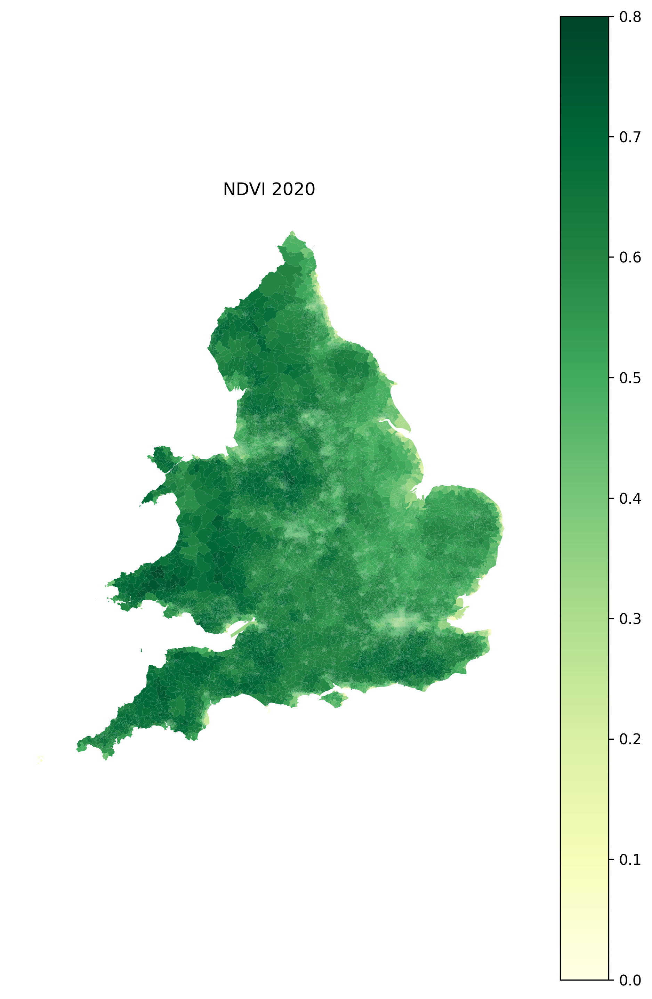

# LSOA 2021 Exposure Data Pipeline

This repository contains scripts and reusable helpers for preparing environmental and contextual datasets for English 2021 Lower-layer Super Output Areas (LSOAs). Workflows cover geographic crosswalks, population estimates, DEFRA air pollution, ozone, OHID Fingertips indicators, and a JAXA binary-grid reader.

Several inputs are not measured on 2021 LSOA boundaries. Historical population counts are allocated using geographic area weights, and Fingertips LAD-level values are assigned to each LSOA in that LAD. These are derived or contextual values, not independently estimated small-area measurements.

The NDVI maps below are retained as example figures. The repository does not currently include a workflow to produce them; the Python helper joins an existing NDVI summary table to administrative polygons.

<figure style="width: 50%; max-width: 700px; margin: 0;">
  <table role="presentation" style="width: 100%; border-collapse: collapse; table-layout: fixed;">
    <tr>
      <td style="width: 50%; padding: 0 4px 0 0; vertical-align: top;">
        
      </td>
      <td style="width: 50%; padding: 0 0 0 4px; vertical-align: top;">
        
      </td>
    </tr>
  </table>
  <figcaption><strong>Example figures:</strong> NDVI maps for 2003 and 2020.</figcaption>
</figure>

## Repository layout

```text
.
├── air_extract.R
├── fingertips.R
├── lsoa11221.R
├── ozone.R
├── pop.R
├── read_defra_pollutant.R
├── read_jaxa.R
├── functions/
│   ├── README.md
│   ├── join_ndvi_adm3.py
│   └── *_functions.R
├── figure/
└── data/ and outputs/  (created locally; excluded from version control)
```

Run R scripts from the repository root so `here::here()` resolves paths as expected. The `data/` and `outputs/` folders are intentionally not committed; obtain the source data separately and check each script's input filenames and assumptions.

## Script guide

| Script | Purpose | Main outputs |
|---|---|---|
| [`lsoa11221.R`](lsoa11221.R) | Reads England LSOA 2001, 2011, and 2021 boundaries and lookup files; creates spatial objects and area-weighted crosswalks. | `data/derived/lsoa_*_area_weights.csv` |
| [`pop.R`](pop.R) | Harmonises annual population estimates for 2002–2024 to LSOA 2021. Historical counts for 2002–2010 are area-weighted from LSOA 2011. | `data/pop_regrouped_2002_2024.csv` |
| [`read_defra_pollutant.R`](read_defra_pollutant.R) | Converts annual DEFRA PCM CSVs for the configured pollutant to GeoTIFFs, aligns their common overlap, and writes diagnostic maps. Configure `pollutant` in the script and run once per pollutant. | `data/defra/<pollutant>/{geotiff,geotiff_overlap,plots}/` |
| [`air_extract.R`](air_extract.R) | Extracts area-weighted means for benzene, PM2.5, PM10, and NOx from overlap rasters to LSOA 2021 boundaries. | `outputs/air_lsoa_eng.gpkg` |
| [`ozone.R`](ozone.R) | Processes annual ozone PCM CSVs and extracts LSOA-level values, with exact, polygon, and point fallbacks. | `outputs/ozone_lsoa_yearly/` |
| [`fingertips.R`](fingertips.R) | Retrieves APS adult smoking prevalence from OHID Fingertips at LAD level and joins it to LSOA 2021 areas. | `data/derived/lsoa2021_smoking_aps_{long,wide}.csv` |
| [`read_jaxa.R`](read_jaxa.R) | Reads configured JAXA MODIS/SeaWiFS SWR binary grids and writes GeoTIFFs and optional PNGs. | `outputs/swr/` |
| [`functions/`](functions/) | Reusable R modules and the NDVI administrative-boundary join utility. See [`functions/README.md`](functions/README.md). | Depends on the selected helper |

The stand-alone `read_defra_pollutant.R` script and reusable `functions/read_defra_functions.R` module cover the same broad DEFRA conversion task. Use the script for its fixed, editable configuration, or source the module to call its functions from another R workflow.

## Inputs and execution order

1. Download the required LSOA boundary shapefiles and lookup CSVs into `data/lsoa/`. Filenames are configured near the top of `lsoa11221.R`.
2. Download ONS single-year-of-age population workbooks into `data/lsoa_pop_est_sing/`.
3. Run `lsoa11221.R` to generate the crosswalk tables and objects required by `pop.R`.
4. Run `pop.R` to generate the harmonised population CSV.
5. Download annual DEFRA PCM CSVs from [UK-AIR](https://uk-air.defra.gov.uk/data/pcm-data) into pollutant folders under `data/defra/`. Configure and run `read_defra_pollutant.R` for each of `benzene`, `pm25`, `pm10`, and `nox`.
6. Run `air_extract.R` after all required pollutant-year overlap rasters are available. It expects 2003–2024 rasters for all four pollutants.
7. Put ozone PCM CSVs in `data/defra/ozone/`, then run `ozone.R`.
8. Put the LSOA 2011-to-LSOA 2021-to-LAD 2022 exact-fit lookup in `data/lsoa/`, then run `fingertips.R`. It retrieves indicator data from [OHID Fingertips](https://fingertips.phe.org.uk/).

`read_jaxa.R` is independent of the LSOA workflows. Verify its product-specific binary layout, scale, byte order, and missing-value settings before using it.

Useful source datasets:

- [ONS Open Geography Portal](https://geoportal.statistics.gov.uk/) for LSOA boundaries and lookup files.
- [ONS small-area population estimates](https://www.ons.gov.uk/peoplepopulationandcommunity/populationandmigration/populationestimates/datasets/smallareapopulationestimatesinenglandandwales) for population workbooks.
- [DEFRA UK-AIR PCM data](https://uk-air.defra.gov.uk/data/pcm-data) for annual pollutant grids.
- [OHID Fingertips](https://fingertips.phe.org.uk/) for indicator data.

## Requirements

R packages vary by workflow. Common packages include `sf`, `terra`, `here`, `dplyr`, `data.table`, `readr`, `readxl`, `tidyr`, `purrr`, `stringr`, `tibble`, `future`, `parallelly`, and `ggplot2`; `exactextractr` is needed for exact ozone extraction, and `fingertipsR` is required for the Fingertips workflow. Install the packages needed by the scripts you plan to run. Spatial R packages may also require GDAL, GEOS, PROJ, and UDUNITS system libraries.

The NDVI join utility requires Python with `geopandas` and `pandas`:

```powershell
python -m pip install geopandas pandas
python functions/join_ndvi_adm3.py --help
```

## Interpretation and quality checks

- Area weights transfer additive counts under a uniform-within-source-area assumption. Do not apply them directly to rates, percentages, or means; transfer numerators and denominators separately where possible.
- `fingertips.R` assigns one LAD-level APS value to all constituent LSOAs. It also uses documented pragmatic replacements and imputations; review these before analysis.
- `ozone.R` records fallback behavior in its summary. Point-fallback values are not area-weighted estimates.
- Check source release versions, units, coordinate systems, years, missing values, crosswalk weight sums, duplicate LSOA-year rows, and output coverage before using results.
- Record download dates, source metadata, and any allocation or imputation rules alongside derived data.

## Citation

Please cite the original data providers (ONS, DEFRA/UK-AIR, and OHID) and comply with their terms. If you use this repository, cite:

Suen, M. H. (2026). *LSOA 2021 Exposure Data Pipeline: Harmonised Environmental and Contextual Exposure Data for English 2021 Lower-layer Super Output Areas* (Version 1.0) [Computer software]. GitHub. https://github.com/enoch26/cd3

```bibtex
@misc{suen2026lsoa,
  author = {Suen, Man Ho},
  title = {LSOA 2021 Exposure Data Pipeline: Harmonised Environmental and Contextual Exposure Data for English 2021 Lower-layer Super Output Areas},
  year = {2026},
  version = {1.0},
  url = {https://github.com/enoch26/cd3},
  note = {R scripts and workflows for generating annual environmental and contextual exposure datasets on 2021 English LSOA boundaries}
}
```
