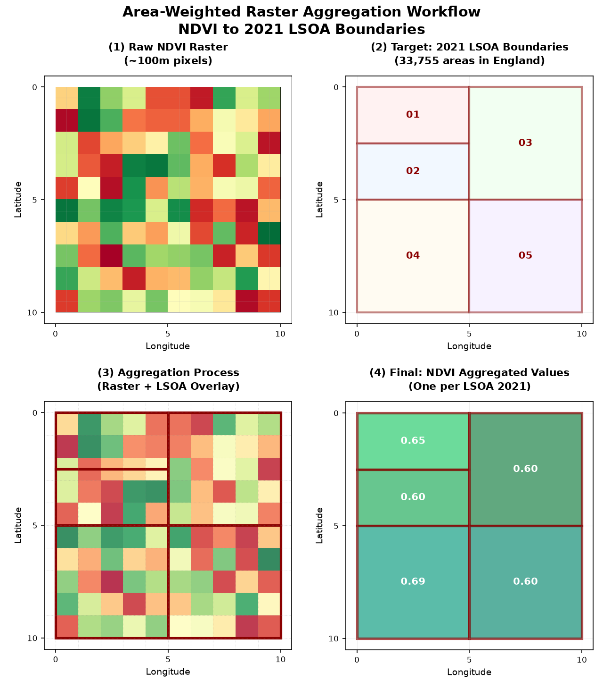

# LSOA 2021 Exposure Data Pipeline

This repository contains scripts and reusable helpers for preparing environmental and contextual datasets for English 2021 Lower-layer Super Output Areas (LSOAs). Workflows cover geographic crosswalks, population estimates, DEFRA air pollution, OHID Fingertips indicators, and a JAXA binary-grid reader.

This project is part of the [CD3 Programme](https://www.cd3.org.uk/), which aims to map cancer disease risk to environmental exposures.

Several inputs are not measured on 2021 LSOA boundaries. Historical population counts are allocated using geographic area weights, and Fingertips LAD-level values are assigned to each LSOA in that LAD. These are derived or contextual values, not independently estimated small-area measurements.

The NDVI maps below are retained as example figures showing normalized difference vegetation index (NDVI) aggregated to LSOA boundaries. The repository does not currently include a workflow to produce them; the Python helper joins an existing NDVI summary table to administrative polygons.

### Animated NDVI Time Series (2003–2020)

<figure style="width: 50%; max-width: 800px; margin: 20px auto;">
  
  <figcaption><strong>Animation:</strong> Normalized Difference Vegetation Index (NDVI) aggregated to LSOA boundaries, 2003–2020. Loop duration: 1 second per frame.</figcaption>
</figure>

### LSOA Aggregation Workflow

<figure style="width: 100%; margin: 20px 0;">
  
  <figcaption><strong>Figure 2:</strong> LSOA aggregation workflow. <strong>Main workflow (Panels 1–4):</strong> Continuous raster data (NDVI, temperature, air pollution) is aggregated directly to 2021 LSOA boundaries without intermediate projection. (Panel 1) Raw raster grid. (Panel 2) Target 2021 LSOA boundaries (33,755 areas in England). (Panel 3) Overlay of raster cells on LSOA polygons. (Panel 4) Final aggregated values computed as area-weighted means of raster cells within each LSOA, ready for analysis. <strong>Alternative workflow (Panel 5):</strong> For legacy data already on 2011 LSOA boundaries, <code>lsoa11221.R</code> or <a href="lsoa11221.py"><code>lsoa11221.py</code></a> computes area-weighted crosswalks to project onto 2021 boundaries; shown here because 2011 and 2021 boundaries misalign (one 2011 LSOA may split into multiple 2021 LSOAs). This workflow figure was generated using Python (<code>matplotlib</code>, <code>geopandas</code>); a similar visualization can be reproduced by adapting the boundary-loading and aggregation logic from <a href="lsoa11221.py"><code>lsoa11221.py</code></a> and <a href="air_extract.py"><code>air_extract.py</code></a>.</figcaption>
</figure>

**Aggregation methodology:** The main workflow applies area-weighted aggregation directly to raster data:
- For each LSOA polygon, compute the weighted mean of all raster cells that intersect it
- Weight each cell by its intersection area with the LSOA
- This approach assumes uniform within-LSOA distribution and is appropriate for continuous measures like NDVI, temperature, and air quality indices

**Legacy data projection:** When data are pre-aggregated to 2011 LSOA boundaries (e.g., historical population counts), use the separate projection workflow shown in Panel 5. LSOA boundaries changed between 2011 and 2021 censuses; one 2011 LSOA may now be split into multiple 2021 LSOAs. The crosswalk matrices computed by <a href="lsoa11221.py"><code>lsoa11221.py</code></a> allocate 2011 data proportionally by intersection area, ensuring historical datasets are harmonized to current boundaries.

## Repository layout

```text
.
├── air_extract.R
├── fingertips.R
├── lsoa11221.R
├── pop.R
├── read_defra_pollutant.R
├── read_defra_pollutant_backup.R
├── read_jaxa.R
├── functions/
│   ├── README.md
│   ├── join_ndvi_adm3.py
│   └── *_functions.R
├── figure/
└── data/ and outputs/  (created locally; excluded from version control)
```

Run R scripts from the repository root so `here::here()` resolves paths as expected. The `data/` and `outputs/` folders are intentionally not committed; obtain the source data separately and check each script's input filenames and assumptions.

## For AI Assistants and Copilot Users

See [`.github/copilot-instructions.md`](.github/copilot-instructions.md) for detailed guidance on working in this repository, including:
- Script execution order and dependencies
- Key conventions (path resolution, configuration patterns, area-weighting rules)
- Data validation expectations
- Troubleshooting common issues

## Script guide

### R scripts

| Script | Purpose | Main outputs |
|---|---|---|
| [`lsoa11221.R`](lsoa11221.R) | Reads England LSOA 2001, 2011, and 2021 boundaries and lookup files; creates spatial objects and area-weighted crosswalks. | `data/derived/lsoa_*_area_weights.csv` |
| [`pop.R`](pop.R) | Harmonises annual population estimates for 2002–2024 to LSOA 2021. Historical counts for 2002–2010 are area-weighted from LSOA 2011. | `data/pop_regrouped_2002_2024.csv` |
| [`read_defra_pollutant.R`](read_defra_pollutant.R) | Converts annual DEFRA PCM CSVs for the configured pollutant to GeoTIFFs, aligns their common overlap, and writes diagnostic maps. Configure `pollutant` in the script and run once per pollutant. | `data/defra/<pollutant>/{geotiff,geotiff_overlap,plots}/` |
| [`air_extract.R`](air_extract.R) | Extracts area-weighted means for benzene, PM2.5, PM10, and NOx from overlap rasters to LSOA 2021 boundaries. | `outputs/air_lsoa_eng.gpkg` |
| [`fingertips.R`](fingertips.R) | Retrieves APS adult smoking prevalence from OHID Fingertips at LAD level and joins it to LSOA 2021 areas. | `data/derived/lsoa2021_smoking_aps_{long,wide}.csv` |
| [`read_jaxa.R`](read_jaxa.R) | Reads configured JAXA MODIS/SeaWiFS SWR binary grids and writes GeoTIFFs and optional PNGs. | `outputs/swr/` |
| [`functions/`](functions/) | Reusable R modules and the NDVI administrative-boundary join utility. See [`functions/README.md`](functions/README.md). | Depends on the selected helper |

### Python equivalents

| Script | Purpose | Main outputs |
|---|---|---|
| [`lsoa11221.py`](lsoa11221.py) | Python equivalent: Reads England LSOA 2001, 2011, and 2021 boundaries and lookup files; creates area-weighted crosswalks using geopandas. | `data/derived/lsoa_*_area_weights.csv` |
| [`pop.py`](pop.py) | Python equivalent: Harmonises annual population estimates for 2002–2024 to LSOA 2021. Applies area weights from 2011 to 2021 for historical years. | `data/pop_regrouped_2002_2024.csv` |
| [`read_defra_pollutant.py`](read_defra_pollutant.py) | Python equivalent: Converts annual DEFRA PCM CSVs to GeoTIFFs using rasterio, aligns rasters to common overlap, and optionally extracts to LSOAs. | `data/defra/<pollutant>/{geotiff,geotiff_overlap}/` |
| [`air_extract.py`](air_extract.py) | Python equivalent: Extracts area-weighted means for benzene, PM2.5, PM10, and NOx from overlap rasters to LSOA 2021 GeoDataFrame, saves as GeoPackage. | `outputs/air_lsoa_eng.gpkg` |
| [`fingertips.py`](fingertips.py) | Python equivalent: Retrieves APS adult smoking prevalence from OHID Fingertips and joins to LSOA 2021 areas. Includes pragmatic adjustments and imputations. | `data/derived/lsoa2021_smoking_aps_{long,wide}.csv` |
| [`read_jaxa.py`](read_jaxa.py) | Python equivalent: Reads JAXA MODIS/SeaWiFS SWR binary grids using NumPy, converts to physical units, and writes GeoTIFFs with optional PNG visualization. | `outputs/swr/` |

The stand-alone `read_defra_pollutant.R` script and reusable `functions/read_defra_functions.R` module cover the same broad DEFRA conversion task. Use the script for its fixed, editable configuration, or source the module to call its functions from another R workflow. Python equivalents are provided as standalone scripts with comparable functionality.

## Inputs and execution order

### R workflow

1. Download the required LSOA boundary shapefiles and lookup CSVs into `data/lsoa/`. Filenames are configured near the top of `lsoa11221.R`.
2. Download ONS single-year-of-age population workbooks into `data/lsoa_pop_est_sing/`.
3. Run `lsoa11221.R` to generate the crosswalk tables and objects required by `pop.R`.
4. Run `pop.R` to generate the harmonised population CSV.
5. Download annual DEFRA PCM CSVs from [UK-AIR](https://uk-air.defra.gov.uk/data/pcm-data) into pollutant folders under `data/defra/`. Configure and run `read_defra_pollutant.R` for each of `benzene`, `pm25`, `pm10`, and `nox`.
6. Run `air_extract.R` after all required pollutant-year overlap rasters are available. It expects 2003–2024 rasters for all four pollutants.
7. Put the LSOA 2011-to-LSOA 2021-to-LAD 2022 exact-fit lookup in `data/lsoa/`, then run `fingertips.R`. It retrieves indicator data from [OHID Fingertips](https://fingertips.phe.org.uk/).

`read_jaxa.R` is independent of the LSOA workflows. Verify its product-specific binary layout, scale, byte order, and missing-value settings before using it.

### Python workflow

Equivalent Python scripts follow the same order and dependencies:

1. Prepare data as above.
2. Run `lsoa11221.py` to generate area-weight crosswalks.
3. Run `pop.py` to harmonise population data to LSOA 2021.
4. Run `read_defra_pollutant.py` for each pollutant to convert CSVs to GeoTIFFs and align rasters.
5. Run `air_extract.py` to extract pollutant concentrations to LSOA 2021 GeoPackage.
6. Run `fingertips.py` to retrieve and join smoking prevalence data.
7. Run `read_jaxa.py` independently to process JAXA binary grids.

Run Python scripts from the repository root using `python lsoa11221.py` etc.

Useful source datasets:

- [ONS Open Geography Portal](https://geoportal.statistics.gov.uk/) for LSOA boundaries and lookup files.
- [ONS small-area population estimates](https://www.ons.gov.uk/peoplepopulationandcommunity/populationandmigration/populationestimates/datasets/smallareapopulationestimatesinenglandandwales) for population workbooks.
- [DEFRA UK-AIR PCM data](https://uk-air.defra.gov.uk/data/pcm-data) for annual pollutant grids.
- [OHID Fingertips](https://fingertips.phe.org.uk/) for indicator data.

## Requirements

### R environment

R packages vary by workflow. Common packages include `sf`, `terra`, `here`, `dplyr`, `data.table`, `readr`, `readxl`, `tidyr`, `purrr`, `stringr`, `tibble`, `future`, `parallelly`, and `ggplot2`; `fingertipsR` is required for the Fingertips workflow. Install the packages needed by the scripts you plan to run. Spatial R packages may also require GDAL, GEOS, PROJ, and UDUNITS system libraries.

### Python environment

Python equivalents require the following packages:

```bash
python -m pip install geopandas pandas numpy rasterio rioxarray matplotlib requests
```

Core dependencies:
- **geopandas**: Spatial data processing (LSOA boundaries, joins)
- **pandas**: Tabular data manipulation
- **numpy**: Numerical operations and array handling
- **rasterio**: GeoTIFF and raster file I/O
- **rioxarray**: Optional, for advanced raster operations
- **matplotlib**: PNG visualization and diagnostic plots
- **requests**: HTTP API access (Fingertips data retrieval)

System libraries required: GDAL, GEOS, PROJ (similar to R requirements).

The NDVI join utility requires Python with `geopandas` and `pandas`:

```powershell
python -m pip install geopandas pandas
python functions/join_ndvi_adm3.py --help
```

## Interpretation and quality checks

- Area weights transfer additive counts under a uniform-within-source-area assumption. Do not apply them directly to rates, percentages, or means; transfer numerators and denominators separately where possible.
- `fingertips.R` assigns one LAD-level APS value to all constituent LSOAs. It also uses documented pragmatic replacements and imputations; review these before analysis.
- Check source release versions, units, coordinate systems, years, missing values, crosswalk weight sums, duplicate LSOA-year rows, and output coverage before using results.
- Record download dates, source metadata, and any allocation or imputation rules alongside derived data.

## Citation

Please cite the original data providers (ONS, DEFRA/UK-AIR, and OHID) and comply with their terms. If you use this repository, cite:

Suen, M. H. (2026). *LSOA 2021 Exposure Data Pipeline: Harmonised Environmental and Contextual Exposure Data for English 2021 Lower-layer Super Output Areas* (Version 1.0) [Computer software]. GitHub. https://github.com/enoch26/cd3

```bibtex
@misc{suen2026lsoa,
  author = {Suen, Man Ho},
  title = {LSOA 2021 Exposure Data Pipeline: Harmonised Environmental and Contextual Exposure Data for English 2021 Lower-layer Super Output Areas},
  year = {2026},
  version = {1.0},
  url = {https://github.com/enoch26/cd3},
  note = {R scripts and workflows for generating annual environmental and contextual exposure datasets on 2021 English LSOA boundaries}
}
```
